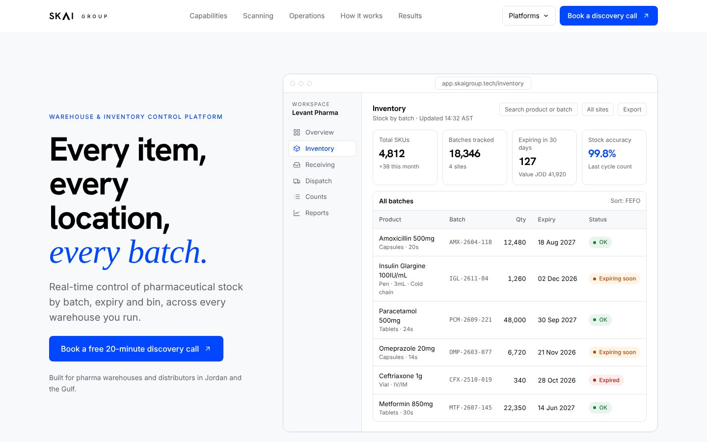
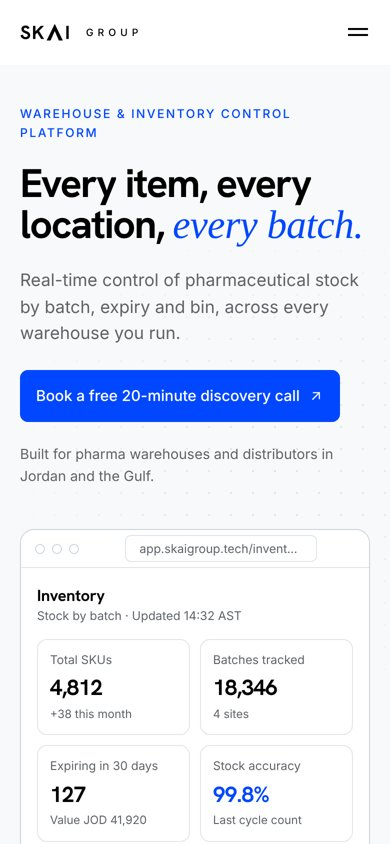

# SKAI Group · Healthcare Platforms

Product landing pages for **SKAI Group**'s healthcare software, built for pharmaceutical warehouses, medical distributors and healthcare logistics teams in Jordan and the Gulf.


## Platforms

| Route | Platform | Track |
|---|---|---|
| `/inventory/` | Warehouse & Inventory Control Platform | IT Transformation |
| `/business/` | Business Management Platform | IT Transformation |
| `/supply-chain/` | Intelligent Warehouse & Supply Chain Platform | AI Transformation |
| `/cold-chain/` | Temperature-Protected Supply Chain | AI Transformation |
| `/business-ai/` | Intelligent Business Management Platform | AI Transformation |

| Inventory | Supply chain | Business AI |
|---|---|---|
|  |  |  |

## Highlights

- **Static and dependency-free:** plain HTML, CSS and JavaScript, so it can be hosted anywhere.
- **Responsive by design:** phone layouts are purpose-built; tables become cards and charts scale to full width.
- **Motion with restraint:** scroll reveals, count-up figures, drawn-in charts, a moving feature band, a cursor-aware hero, 3D product tilt and a live temperature feed, all switched off for visitors who prefer reduced motion.
- **Bilingual product demos:** the assistant mockups answer in Arabic (right-to-left) and English.
- **Brand system:** white, black and Electric Cobalt (`#0047FF`); Hanken Grotesk for headings and Inter for text.



## Project structure

```
assets/   shared CSS, JavaScript and favicon
build/    page sources (Python generates dist/)
dist/     ready-to-host site
```

## Develop

```bash
python3 build/build.py                          # rebuild dist/ after editing a page
python3 -m http.server 8080 --directory dist     # preview at http://localhost:8080
```

## Deploy

`dist/` is a static site. On Replit it deploys as a **Static** deployment (configured in `.replit`); it works the same on Netlify, Vercel, Cloudflare Pages or GitHub Pages.

---

© 2026 SKAI Group · Amman, Jordan · [skaigroup.tech](https://skaigroup.tech)
